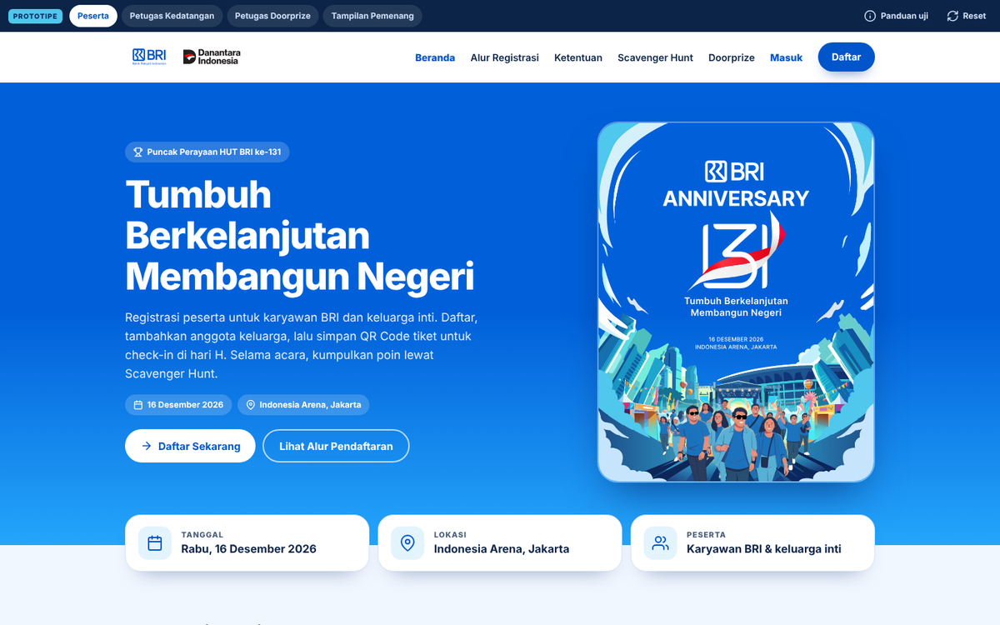
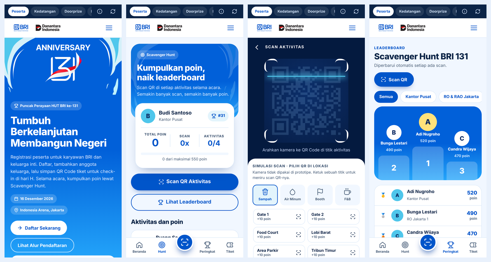
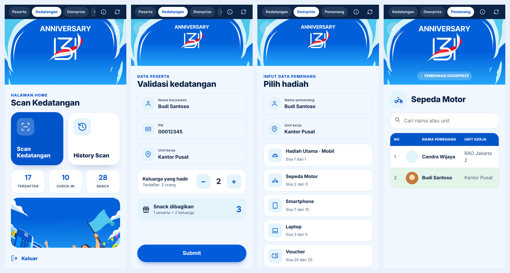
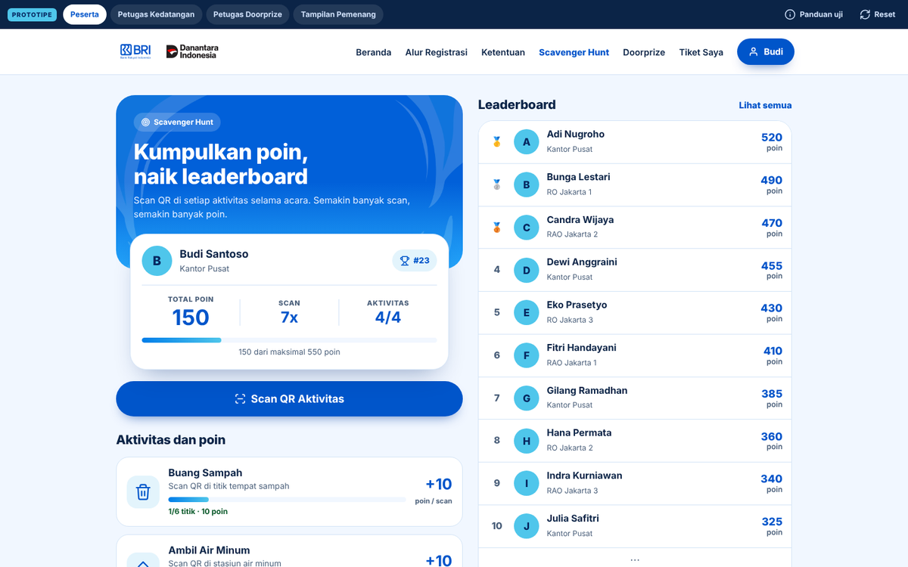

# BRI 131 Anniversary: Prototipe Microsite dan Sistem

Prototipe interaktif untuk acara HUT BRI ke-131 (16 Desember 2026, Indonesia Arena, Jakarta). Berjalan di browser HP maupun desktop, tanpa server dan tanpa instalasi.



## Isi prototipe

Satu halaman (`index.html`) dengan empat mode. Pindah mode lewat bilah gelap di bagian atas.

| Mode | Isi |
|---|---|
| **Peserta** | Beranda, registrasi (login BRIStars, data diri, keluarga inti, Ikuti Event), tiket QR, contoh email konfirmasi |
| **Scavenger Hunt** | Scan QR aktivitas (Buang Sampah, Ambil Air Minum, Kunjungan Booth, Belanja di Area F&B), poin otomatis, riwayat scan, leaderboard dengan filter unit |
| **Petugas Kedatangan** | Login, scan tiket peserta, jumlah keluarga hadir, pembagian snack, submit check-in, history scan |
| **Petugas Doorprize** | Login, scan pemenang, pilih hadiah, foto pemenang (opsional), kuota hadiah, riwayat |
| **Tampilan Pemenang** | Daftar hadiah dan tabel pemenang yang terisi langsung saat petugas mencatat pemenang |

Tombol **Panduan uji** di bilah atas menuntun enam langkah uji dari pendaftaran sampai tampilan pemenang. Tombol **Reset** mengembalikan semua data ke awal.







## Menjalankan

Buka `index.html` langsung di browser, atau jalankan server lokal:

```bash
python3 -m http.server 8000
# buka http://localhost:8000
```

Untuk mencoba di HP, buka alamat GitHub Pages (lihat di bawah), atau buka `http://<IP-komputer>:8000` dari HP yang terhubung ke Wi-Fi yang sama.

## Deploy ke GitHub Pages

1. Unggah semua isi folder ini ke repositori GitHub (branch `main`).
2. Buka **Settings > Pages**.
3. Pada **Build and deployment**, pilih **Deploy from a branch**, branch `main`, folder `/ (root)`, lalu **Save**.
4. Tunggu satu sampai dua menit. Alamatnya: `https://<username>.github.io/<nama-repo>/`.

GitHub Pages untuk repositori privat memerlukan paket GitHub berbayar (Pro, Team, atau Enterprise).

## Struktur folder

```
index.html            hasil build, satu berkas mandiri (ini yang dipublikasikan)
build.py              merakit src/ dan assets/ menjadi index.html
src/
  style.css           seluruh gaya (tema warna KV HUT 131)
  icons.json          ikon SVG
  js/
    01-data-state.js        data contoh, state, logika poin dan peringkat
    02-router-peserta.js    router, kerangka, beranda, registrasi, tiket
    03-hunt-leaderboard.js  Scavenger Hunt, scan, poin berhasil, leaderboard, modal
    04-petugas-display.js   aplikasi petugas dan tampilan pemenang, render
    05-aksi-boot.js         aksi tombol, event, mulai
assets/               logo BRI, Danantara, logo 131, ilustrasi KV
docs/img/             tangkapan layar untuk README
```

## Mengubah dan membangun ulang

Edit berkas di `src/`, lalu:

```bash
python3 build.py
```

Hanya butuh Python 3, tanpa paket tambahan. Hasilnya menimpa `index.html`.

Data contoh ada di `src/js/01-data-state.js`:

| Konstanta | Fungsi |
|---|---|
| `CATS` | Aktivitas Scavenger Hunt: nama, poin per scan, daftar titik QR |
| `PRIZES` | Daftar hadiah dan kuota |
| `UNITS` | Pilihan unit kerja yang berhak ikut |
| `LB_SEED` | Peserta contoh di leaderboard |
| `SEED_PEOPLE` | Peserta contoh yang terdaftar (untuk petugas) |
| `DIRECTORY` | Akun demo (PN `00012345`) |

## Aturan contoh yang dipakai

Semua ini usulan dan dapat disesuaikan panitia:

- Poin per scan: Buang Sampah 10, Ambil Air Minum 10, Kunjungan Booth 20, Belanja di Area F&B 30.
- Satu QR aktivitas hanya dapat di-scan satu kali per peserta.
- Satu peserta hanya dapat memenangkan satu hadiah, dan hanya peserta yang sudah check-in yang dapat menerima hadiah.
- Peserta area Kalimantan tidak termasuk dalam acara (sesuai ketentuan di deck registrasi).

## Batasan prototipe

- **Scan disimulasikan.** Kamera tidak dipakai. Pengguna mengetuk titik atau peserta yang ingin "di-scan". QR di tiket adalah gambar contoh, belum QR yang dapat dibaca.
- **Data tersimpan per perangkat** di `localStorage`. Poin dan check-in di HP tidak muncul di desktop. Jika browser memblokir penyimpanan, data hilang saat halaman dimuat ulang.
- **Login tidak diperiksa.** PN cukup 8 digit dan kata sandi boleh sembarang.
- **Peserta lain, leaderboard, dan pemenang awal adalah data contoh.**

## Menuju sistem sebenarnya

Yang perlu disediakan di sisi server agar prototipe ini menjadi sistem nyata:

- Autentikasi ke BRIStars dan data karyawan (PN, unit kerja).
- Database peserta, keluarga, check-in, poin, dan pemenang, dengan satu API gateway.
- QR tiket dan QR aktivitas yang unik dan bertanda tangan, dibaca lewat kamera.
- Pembatasan satu QR satu scan per peserta di server, bukan di browser.
- Leaderboard dan tampilan pemenang yang membaca data dari API secara langsung.

## Catatan aset merek

Logo BRI, Danantara Indonesia, logo 131 Anniversary, dan ilustrasi KV di folder `assets/` adalah aset milik pemiliknya masing-masing. Simpan repositori ini sebagai **privat** dan jangan dipublikasikan ke publik tanpa izin.
